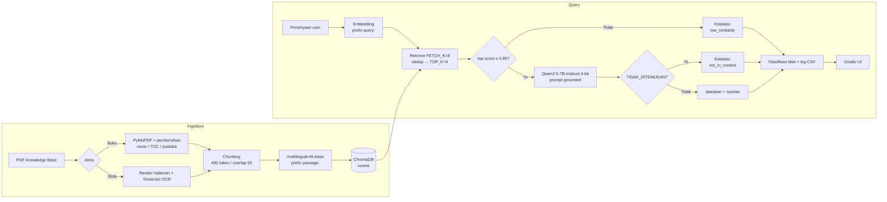

<div align="center">

# 🛠️ IT Service Desk RAG Assistant

**Asisten service desk berbasis RAG dengan LLM open source: menjawab keluhan IT dari knowledge base, menyertakan sumber, dan mengeskalasi ke agent manusia saat tidak yakin.**


-6f42c1)


[](https://colab.research.google.com/github/<USERNAME>/it-service-desk-rag/blob/main/notebooks/IT_Service_Desk_RAG.ipynb)

</div>

> **TL;DR (English):** A fully open-source RAG assistant for IT service desks. It answers questions in Indonesian from a PDF knowledge base (with OCR for slide decks), cites sources, refuses out-of-scope questions via a data-calibrated similarity threshold plus an LLM answerability check, auto-classifies tickets, logs them, and ships with an evaluation pipeline (Hit@k, MRR, RAGAS, ticket-classification accuracy). Runs on a single free Colab T4.

<!-- GANTI: tempel GIF demo di sini (lihat assets/README.md) -->
<!-- <p align="center"></p> -->

---

## 📌 Daftar Isi
- [Latar Belakang](#-latar-belakang)
- [Fitur Utama](#-fitur-utama)
- [Arsitektur](#-arsitektur)
- [Tech Stack](#-tech-stack)
- [Hasil Evaluasi](#-hasil-evaluasi)
- [Perjalanan Iterasi (v1 → v3)](#-perjalanan-iterasi-v1--v3)
- [Cara Menjalankan](#-cara-menjalankan)
- [Struktur Repo](#-struktur-repo)
- [Keputusan Desain](#-keputusan-desain)
- [Keterbatasan Jujur](#-keterbatasan-jujur)
- [Roadmap](#-roadmap)
- [Lisensi & Data](#-lisensi--data)

---

## 🎯 Latar Belakang

Tim IT service desk menerima pertanyaan berulang ("Wi-Fi lambat", "cara reset password", "printer tidak terdeteksi") yang jawabannya sebenarnya sudah ada di dokumen SOP dan buku panduan. Proyek ini membangun asisten yang:

1. mencari jawaban di knowledge base internal, bukan dari "ingatan" LLM,
2. **tidak mengarang**: kalau jawabannya tidak ada, tiket dieskalasi ke agent manusia,
3. berjalan **100% dengan model open source**, tanpa API berbayar.

Proyek ini dibuat sebagai tugas besar kelas *AI Engineer* (topik LLM + RAG dengan model open source) dan sengaja difokuskan pada **evaluasi yang jujur**, bukan hanya demo yang terlihat bagus.

## ✨ Fitur Utama

| Fitur | Penjelasan |
|---|---|
| **Ingestion PDF + OCR** | Buku dibersihkan (cover, daftar isi, daftar pustaka dibuang); slide berbasis gambar dibaca dengan Tesseract (`ind+eng`); password hasil OCR di-mask. |
| **Retrieval bebas duplikat** | Ambil `FETCH_K=8` kandidat, buang chunk berteks sama, kirim `TOP_K=4` chunk unik ke LLM. |
| **Guardrail dua lapis** | (1) Ambang *similarity* yang **dikalibrasi dari data** (split dev), (2) LLM boleh membalas `TIDAK_DITEMUKAN` bila konteks tidak memuat jawaban → eskalasi. |
| **Jawaban ter-grounding + sitasi** | Prompt membatasi jawaban hanya pada konteks; sumber (file dan skor kemiripan) ditampilkan di UI; nomor halaman tersimpan di log. |
| **Klasifikasi tiket** | Hardware / Software / Network / Hosting / Access-Akun / Lainnya, opsional dengan petunjuk konteks hasil retrieval. |
| **Logging tiket** | Setiap interaksi dicatat ke `ticket_log.csv` (ID tiket, kategori, eskalasi, skor, sumber). |
| **UI Gradio** | Chat web dengan kategori tiket dan sumber di setiap jawaban. |
| **Pipeline evaluasi lengkap** | Test set otomatis per kategori → review manual → kalibrasi (dev) → evaluasi (test) → Hit@k/MRR, RAGAS, akurasi klasifikasi. |

## 🏗️ Arsitektur



Detail tiap tahap ada di [`docs/architecture.md`](docs/architecture.md).

## 🧰 Tech Stack

| Lapisan | Pilihan | Alasan singkat |
|---|---|---|
| LLM | `Qwen/Qwen2.5-7B-Instruct`, 4-bit NF4 (bitsandbytes) | Kuat di bahasa Indonesia, muat di T4 15 GB |
| Embedding | `intfloat/multilingual-e5-base` | Multibahasa, dengan prefix `query:` / `passage:` |
| Vector DB | ChromaDB (cosine) | Ringan, persisten, mudah dibackup |
| Orkestrasi | LlamaIndex | Retriever, node, dan metadata |
| Parsing | PyMuPDF, pdf2image, Tesseract (`ind+eng`) | Teks digital + OCR untuk slide |
| Evaluasi | RAGAS 0.1.21, metrik retrieval buatan sendiri | Judge open source, tanpa API berbayar |
| UI | Gradio | Demo cepat, link publik sementara |
| Runtime | Google Colab (T4) | Gratis dan reproducible |

## 📊 Hasil Evaluasi

Dievaluasi pada **split test** (25 soal: 20 in-scope + 5 out-of-scope). Threshold guardrail (0.85) dipilih hanya dari **split dev** (28 soal), jadi tidak bocor ke test.

| Kelompok | Metrik | Hasil |
|---|---|---|
| **Retrieval** (n=20) | Hit@1 / Hit@4 / MRR | **75.0%** / **100%** / **0.858** |
| **Generasi** (RAGAS, n valid=19) | Faithfulness | **0.876** |
| | Answer Relevancy | 0.892 |
| | Context Precision | 0.846 |
| | Context Recall | 0.987 |
| **Proxy tanpa judge** | Grounding leksikal | 0.930 (96,3% kalimat terdukung ≥ 0,7) |
| **Guardrail** | Akurasi OOS (n=5, termasuk near-domain) | 100% |
| | False escalation rate (n=20) | 5% |
| **Klasifikasi tiket** (n=18) | Akurasi | 88,9% |
| **Performa** | Latency rata-rata (T4) | 4,8 detik/pertanyaan |

> ⚠️ Angka di atas berasal dari sampel kecil dengan judge Qwen 7B yang sama dengan generator. Baca bagian [Keterbatasan Jujur](#-keterbatasan-jujur) sebelum membandingkan dengan sistem lain.

Cara tiap metrik dihitung dan analisis kasus gagal: [`docs/evaluation.md`](docs/evaluation.md).

## 📈 Perjalanan Iterasi (v1 → v3)

Tiga iterasi dengan perbaikan berbasis error analysis. Test set tiap versi disusun ulang, jadi tabel ini menunjukkan **tren**, bukan perbandingan apple-to-apple.

| Metrik | v1 (baseline) | v2 | v3 (final) |
|---|---|---|---|
| Faithfulness (RAGAS) | 0.735 *(9 dari 17 baris NaN)* | 0.690 | **0.876** |
| Hit@1 retrieval | n/a | 17.6% | **75.0%** |
| MRR | n/a | 0.556 | **0.858** |
| False escalation rate | 32% | 5.9% | 5% |
| Latency rata-rata | 8.5 s | 15.9 s | **4.8 s** |
| Akurasi klasifikasi | n/a | 78.6% | 88.9% |

Perubahan utama:
- **v1 → v2:** pembersihan cover/daftar isi/pustaka, OCR untuk slide, prefix `query:`/`passage:` pada embedding e5, chat template Qwen, dan pemisahan test set menjadi split dev/test.
- **v2 → v3:** prompt *grounded* dengan 6 aturan eksplisit + token `TIDAK_DITEMUKAN` (benteng guardrail kedua), `FETCH_K=8` → dedup → `TOP_K=4` chunk unik, jawaban ringkas (`MAX_NEW_TOKENS=320`), deduplikasi PDF, proxy faithfulness leksikal, serta penambahan 2 dokumen SOP internal ke knowledge base.

Log lengkap: [`docs/iteration-log.md`](docs/iteration-log.md).

## 🚀 Cara Menjalankan

Notebook dirancang untuk **Google Colab dengan GPU T4**.

1. Klik badge **Open In Colab** di atas.
2. `Runtime → Change runtime type → T4 GPU`.
3. Jalankan sel instalasi. Runtime akan **restart otomatis sekali**; lanjutkan dari sel *Cek GPU* tanpa mengulang instalasi.
4. Saat sel upload muncul, unggah PDF knowledge base milik Anda (lihat [`data/knowledge_base/README.md`](data/knowledge_base/README.md)).
5. Jalankan berurutan sampai bagian **Demo UI Gradio** untuk membuka chat.
6. Untuk mengulang evaluasi: jalankan bagian *Generate Test Set* → review manual CSV → upload → kalibrasi → evaluasi.

**Kebutuhan:** akun Google (Colab), ±15 GB VRAM (T4), koneksi internet untuk mengunduh model (bobot Qwen2.5-7B ±15 GB yang dikuantisasi ke 4-bit saat dimuat, + ±1 GB embedding). Daftar paket ada di [`requirements.txt`](requirements.txt).

<details>
<summary><b>Hyperparameter yang bisa diubah (untuk eksperimen/ablation)</b></summary>

| Parameter | Default | Fungsi |
|---|---|---|
| `CHUNK_SIZE` / `CHUNK_OVERLAP` | 400 / 50 | Ukuran potongan dokumen |
| `FETCH_K` / `TOP_K` | 8 / 4 | Kandidat awal / chunk unik yang dikirim ke LLM |
| `SIMILARITY_THRESHOLD` | 0.85 (hasil kalibrasi) | Batas eskalasi berbasis skor |
| `MAX_NEW_TOKENS` | 320 | Panjang maksimum jawaban |
| `USE_ANSWERABILITY_CHECK` | `True` | Izinkan LLM membalas `TIDAK_DITEMUKAN` |
| `VERIFY_PASS` | `False` | Pass kedua pemangkas klaim tak berdukungan (2× latensi) |

</details>

## 🗂️ Struktur Repo

```text
it-service-desk-rag/
├── README.md
├── LICENSE
├── requirements.txt
├── .gitignore
├── notebooks/
│   └── IT_Service_Desk_RAG.ipynb      # pipeline end-to-end (ingestion → RAG → UI → evaluasi)
├── data/
│   ├── knowledge_base/                # PDF TIDAK di-commit (lihat README di dalamnya)
│   │   └── README.md
│   └── eval/                          # test set hasil review (CSV) + hasil evaluasi
│       └── README.md
├── docs/
│   ├── architecture.md                # detail pipeline & alur data
│   ├── evaluation.md                  # definisi metrik, protokol dev/test, error analysis
│   ├── iteration-log.md               # perubahan v1 → v3 dan alasannya
│   └── limitations-and-roadmap.md
└── assets/                            # screenshot, GIF demo, diagram
    └── README.md
```

Rencana pemecahan notebook menjadi paket Python (`src/`) ada di [`docs/limitations-and-roadmap.md`](docs/limitations-and-roadmap.md).

## 🧠 Keputusan Desain

- **Threshold dikalibrasi, bukan ditebak.** Sweep 0.50–0.95 pada split dev; dipilih threshold terendah yang menjaga akurasi OOS ≥ 90% dengan *false escalation* sekecil mungkin. Ternyata skor similarity e5 sempit (in-scope rata-rata 0.887 vs OOS near-domain 0.840), sehingga threshold saja tidak cukup → ditambah lapisan *answerability check*.
- **Test set mencakup near-domain OOS.** Pertanyaan seperti "reset password Microsoft 365" diaudit terhadap KB; yang topiknya ternyata ada di KB dibuang dari daftar OOS, agar guardrail tidak diuji dengan label yang salah.
- **Split dev/test 50/50**, stratified per kategori (seed tetap). Threshold dipilih di dev, dilaporkan di test.
- **Metrik retrieval tanpa LLM-judge.** Hit@k/MRR dihitung dari kecocokan `file + rentang halaman` sumber soal, jadi bebas bias judge.
- **Proxy faithfulness leksikal.** Pembanding murah dan deterministik untuk skor RAGAS yang bergantung pada judge 7B.
- **Satu kali retrieve per pertanyaan**, hasilnya dipakai ulang untuk guardrail, generasi, dan evaluasi.
- **Error analysis di notebook.** Baris faithfulness terendah dibedah: generator menambah fakta, retrieval meleset, atau judge salah menilai.

## ⚠️ Keterbatasan Jujur

- **Sampel kecil.** Test: 20 in-scope + 5 OOS; klasifikasi n=18. Selisih beberapa poin persen tidak signifikan secara statistik.
- **Judge = generator** (Qwen 7B 4-bit) → potensi bias menilai diri sendiri. Skor RAGAS sebaiknya dibaca bersama Hit@k, proxy leksikal, dan review manual.
- **Soal dibuat oleh LLM dari chunk KB** (lalu direview manual), sehingga cenderung lebih "mudah" daripada pertanyaan user nyata yang berantakan.
- **Cakupan KB sempit** (5 dokumen, 291 chunk). Skor akan turun pada KB yang lebih besar dan bising.
- **OOS hanya 5 soal di test.** "Akurasi guardrail 100%" belum bukti ketahanan.
- **Hanya teks.** Gambar, tabel, dan diagram di dalam PDF belum dipahami.
- **Bahasa:** dioptimalkan untuk bahasa Indonesia.

## 🗺️ Roadmap

- [ ] Pecah notebook menjadi paket `src/` + CLI + FastAPI
- [ ] Reranker (mis. `bge-reranker`) dan *hybrid search* BM25 + vektor
- [ ] Perbesar test set (≥100 soal, termasuk pertanyaan user nyata) dan review oleh orang kedua
- [ ] Judge yang lebih kuat / terpisah dari generator, plus anotasi faithfulness manual
- [ ] Deploy ke Hugging Face Spaces / Docker
- [ ] Percakapan multi-turn dan pengisian slot tiket (prioritas, perangkat, lokasi)
- [ ] Integrasi ke sistem tiket (mis. webhook ke Jira / GLPI)

## 📄 Lisensi & Data

- Kode: [MIT](LICENSE).
- **Knowledge base tidak disertakan.** Sebagian sumber (buku dan slide kuliah) adalah karya berhak cipta pihak lain; unggah dokumen Anda sendiri atau gunakan dokumen SOP buatan sendiri. Lihat [`data/knowledge_base/README.md`](data/knowledge_base/README.md).
- Model: Qwen2.5 (lisensi Apache-2.0 untuk 7B), multilingual-e5 (MIT). Periksa lisensi terbaru masing-masing model sebelum penggunaan komersial.

## 👤 Penulis

**Alif Rachmansyah Muhammad** — calon AI Engineer
[LinkedIn](https://linkedin.com/in/alifrmuhammad) · [GitHub](https://github.com/rachman-alif) · alif.rachmansyah.m@gmail.com

*Dibuat sebagai proyek tugas besar AI Engineer Track (LLM + RAG, model open source).*
